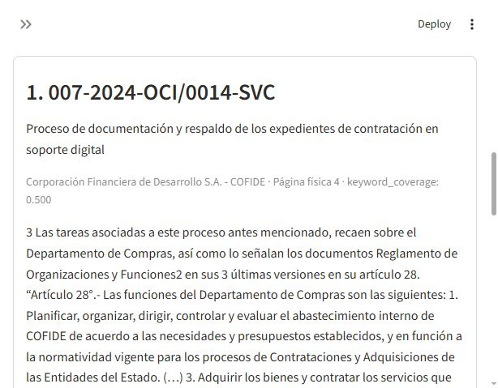
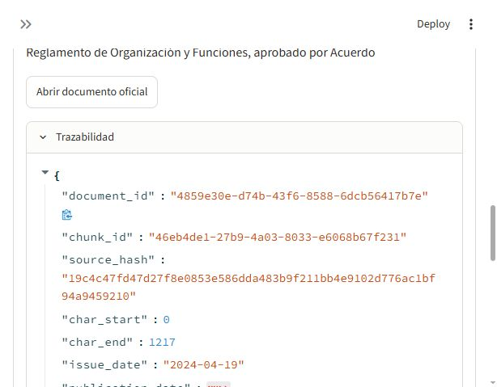

# Demostración documental

La demostración usa el informe completo COFIDE 007-2024-OCI/0014-SVC, de 14 páginas físicas.
No se incluyen PDFs en Git; el manifiesto registra la fuente oficial y el hash esperado.

1. Arrancar la aplicación siguiendo el README. La interfaz está en http://127.0.0.1:8501.
2. Ingerir el manifiesto documental con `--extract-only`, revisar calidad y ejecutar `audit chunk`.
3. En **Buscar**, elegir **Palabras clave** e introducir `respaldos digitales`.
4. Abrir **Trazabilidad** y cotejar hash, offsets y página física con el documento oficial.
5. En **Informes**, consultar el texto conservado. En **Preguntar**, verificar el aviso de
   generación deshabilitada. Las páginas 13 y 14 no tienen cobertura textual completa.

Fuente oficial:
[Informe COFIDE](https://apps8.contraloria.gob.pe/SPIC/srvDownload/ViewPDF?CRES_CODIGO=2024CSI001400007&TIPOARCHIVO=ADJUNTO).

El score de palabras clave representa cobertura de términos; no es probabilidad ni confianza.
La demo no atribuye responsabilidades y no valida respuestas generadas por IA.

## Resultado real comprobado

Consulta: `respaldos digitales`, método keyword, K=5. El primer resultado observado corresponde
a la página física 4, offsets `[0, 1217)` del texto limpio, score keyword_coverage 0.5.
El fragmento identifica al Departamento de Tecnología de la Información en las acciones de respaldo.
Se verificó mediante API que el texto coincide exactamente con ese intervalo de la página.
Este ejemplo demuestra recuperación literal sobre el piloto, no calidad semántica general.

SHA-256: `19c4c47fd47d27f8e0853e586dda483b9f211bb4e9102d776ac1bf94a9459210`.

